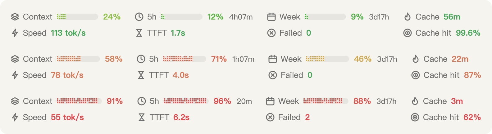

# usage-bar

English | [简体中文](README.zh-CN.md)

A Claude Code mod that draws a status row just above the prompt: your 5-hour and weekly plan limits, how long the prompt cache stays warm, and context use.
A second row shows how the session is running: output speed, time to first token, cache hit rate and failed requests.

<picture>
  <source media="(prefers-color-scheme: dark)" srcset="docs/preview-en-dark.png">
  
</picture>

Each number takes the color of its state, so you can read the row at a glance: green is fine, Claude orange is worth a look, red needs attention.

## Install

At the prompt of a Claude Code terminal session:

```
/plugin install usage-bar --marketplace zgmengde/usage-bar
```

Answer `y` to add the marketplace, then pick a scope (user scope loads it in every session).

From a shell:

```bash
claude plugin install usage-bar --marketplace zgmengde/usage-bar
```

In the desktop app, where `/plugin` does not run: click **+** next to the prompt box, then **Plugins**, **Add marketplace** with `zgmengde/usage-bar`, then **Add plugin**.
A mod installed at the user scope from a terminal also loads in the desktop app's Code tab.

## What it shows

**First row: usage**

| Item | What it means | Color |
|---|---|---|
| Context | How full the context window is, measured against the auto-compact point (the same number `/context` shows). Off by default, since the desktop app already shows it. | Follows the percentage |
| 5h | Share of the 5-hour plan limit used, and the time until it resets. | Follows the percentage |
| Week | Share of the weekly plan limit used, and the time until it resets. | Follows the percentage |
| Cache | How long the main conversation's prompt cache stays warm: `Live` while a turn runs, a countdown after the last turn ends, `Cold` once it expires. | Green while at least half the TTL is left, orange down to 10%, red below that; blue when cold |
| Extra | Any other limit window the API reports, such as a spend limit. Shown only once it passes `conditional_threshold`. | Follows the percentage |
| Cost | The session's estimated API cost. Off by default. On a subscription this is an estimate, not what you pay. | — |

**Second row: performance**

| Item | What it means | Green | Orange | Red |
|---|---|---|---|---|
| Speed | Output tokens per second for this session's main thread. | ≥ 90 | 70–89 | < 70 |
| TTFT | Average seconds from sending a main-thread request until its response starts. | < 3 s | 3–5 s | > 5 s |
| Failed | Requests this session, subagents included, that errored or ended without a response. Requests you interrupt do not count. | 0 | — | > 0 |
| Cache hit | Share of the latest main-thread request's input read from the prompt cache. Marked `Write` when that request wrote more to the cache than it read, which is normal for a first request or one after the cache expired. | ≥ 90% | 85–89% | < 85% |

The second row appears after the session's first request. A `—` means no data yet; for Cache hit, it means the request neither read nor wrote the cache.
Colors are judged on the number as shown, so `90%` is green even when the exact value is 89.6%.

The two rows line up column by column. With `show_context` on, that is Context above Speed, 5h above TTFT, Week above Failed, and Cache above Cache hit.
When the window is too narrow, the bars get shorter first; only when they reach their minimum do the rows fall back to a packed layout.

### How the performance numbers are computed

Speed and time to first token are session totals, summed the way [DeepSeek Harness](https://github.com/deepseek-ai/deepseek-harness) does it in its session stats:

- **TTFT** (time to first token) = total time from each request's start to its first streamed chunk, divided by the number of requests.
- **speed** = total output tokens divided by total time from each first chunk to the end of its response.

Claude Code does not stream thinking text to plugins, but `output_tokens` includes thinking tokens.
So the first chunk counts any chunk, including the engine's own envelope events; counting only visible text would give speeds of over ten thousand tokens per second.
Totals smooth out a single odd request, so there is no outlier filter.

The hit rate is `cache_read / (input + cache_read + cache_creation)` for the latest main-thread request, rounded like DeepSeek Harness: to a whole percent, unless that would show 100% for a request that did not fully hit; then it adds decimal places until it no longer does (99.96%, 99.999%), up to six.

## Settings

Change them in the plugin's settings screen, or in `~/.claude/settings.json` under `pluginConfigs["usage-bar@usage-bar"].options`.

| Key | Default | What it does |
|---|---|---|
| `show_five_hour` | `true` | Show the 5-hour limit. |
| `show_weekly` | `true` | Show the weekly limit. |
| `show_cache` | `true` | Show the prompt-cache countdown. |
| `show_other_limits` | `true` | Show other limit windows once they pass `conditional_threshold`. |
| `show_context` | `false` | Show context use. |
| `show_cost` | `false` | Show the session's estimated cost. |
| `show_reset` | `true` | Show the time left until each limit resets. |
| `show_speed` | `true` | Second row: output speed. |
| `show_first_token` | `true` | Second row: time to first token. |
| `show_cache_hit` | `true` | Second row: cache hit rate. |
| `show_failures` | `true` | Second row: failed requests. |
| `conditional_threshold` | `50` | Percent at which other limits start to show. |
| `layout` | `auto` | `auto` gives usage and performance a row each, and wraps a row that is too narrow. `one-line` puts everything on one row. `two-lines` splits the items into two rows when only one group is shown. |
| `bar` | `dither` | `dither` pixel bars, `solid` filled bars, `none` numbers only. |
| `color` | `by-percent` | `by-percent` blends through the color stops; `threshold` changes color at 80% and 95%; `mono` uses one color. |
| `color_stops` | `0:#46a758,60:#d97757,100:#e5484d` | `percent:#hex` pairs; colors blend by hue between stops. |
| `icons` | `on` | Show an icon before each item. |
| `cache_ttl` | `1h` | Length of the cache countdown. Match it to your prompt-cache TTL (`5m` or `1h`). |
| `notify_at` | `80,95` | Percents of the 5-hour or weekly limit that raise a notification, once per percent per window. Empty turns it off. |
| `language` | `auto` | Label language: `en`, `zh`, or `auto` to follow `LC_ALL` or `LANG`. The desktop app usually has no `LANG`, so set `zh` there if you want Chinese labels. |

The color thresholds of the second row are fixed for now. Green, orange and red are the first, middle and last of `color_stops`, so changing the stops or choosing `mono` changes them too.

## Keeping the row next to the prompt

usage-bar asks the other mods for their part of the band first, puts it above, and draws its own rows last, right on top of the prompt.
If another mod does the same, the one deeper in the hook chain loses.
To make usage-bar the outermost, list it first in `prependPlugins` in `~/.claude/settings.json`:

```json
{
  "prependPlugins": ["usage-bar@usage-bar"]
}
```

Claude Code reads this key from managed settings; on a machine with no managed settings it also reads it from your user settings, for plugins you installed yourself.

## Privacy

- No network access: the mod makes no requests of its own.
- It runs no commands and reads or writes no files of its own. It reads only what Claude Code hands every plugin: the session's usage, rate limits, model, and the `LANG` and `LC_ALL` variables.
- To time requests it sits in the response stream: it notes when chunks arrive and reads each response's token usage and stop reason. It does not read or keep the content, and passes every chunk on unchanged.
- It keeps a few values in its plugin store, `~/.claude/plugins/store/usage-bar_*.json`, so the row survives a restart:
  - the latest limit percentages and reset times (shared by all sessions, since limits belong to the account);
  - the end time of each session's latest turn and its performance totals, keyed by session id, up to 20 sessions;
  - which limit notifications it already sent, up to 50.
- `/clear` deletes the current session's entries. Nothing else leaves your machine.

`claude plugin validate` lists every engine call the mod makes, if you want to check this yourself.

## Limitations

- The row appears once the session's Claude Code process is running. In the desktop app, a new conversation starts that process when you send its first message, so an empty new conversation shows no row.
- Limit percentages come with model responses. A fresh process shows the values saved from the last response until the next one arrives, and they can read about a point lower than the official usage page.
- Plugins do not get the band's pixel width, so the layout works from an estimate (`bodyColumns × 8 px`). The row is centered so the margins stay even, but a text can be off by a few pixels.
- In a terminal there is no SVG: the row falls back to plain text with no icons, padded so the columns still line up.

## Development

```bash
claude plugin validate .   # manifest, hooks and every engine call
claude plugin test .       # unit and render tests
```

To try a change, run `/reload-plugins` in a session that has the mod installed from this folder.
To type-check, start one session with `claude --plugin-dir .` so the engine writes the `claude-code` types to `.claude-plugin/types/`, then run `npx -p typescript tsc -p .`.

## License

[MIT](LICENSE)
