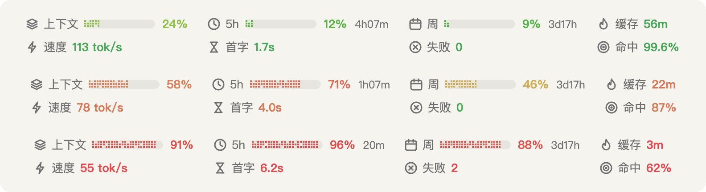

# usage-bar

[English](README.md) | 简体中文

usage-bar 是一个 Claude Code mod，在输入框正上方画一行状态栏。
第一行显示 5 小时额度、每周额度、提示缓存还能热多久，以及上下文用量。
第二行显示本会话的运行情况：输出速度、首字耗时、缓存命中率和失败次数。

<picture>
  <source media="(prefers-color-scheme: dark)" srcset="docs/preview-zh-dark.png">
  
</picture>

每个数值按状态上色：绿色表示正常，Claude 橙表示值得留意，红色表示需要处理。

## 安装

在 Claude Code 终端会话的输入框里执行：

```
/plugin install usage-bar --marketplace zgmengde/usage-bar
```

提示添加市场时输入 `y`，然后选择作用范围。
选 user 范围后，每个会话都会加载它。

在 shell 里执行：

```bash
claude plugin install usage-bar --marketplace zgmengde/usage-bar
```

桌面版不能执行 `/plugin`，按下面的步骤安装：

1. 点击输入框旁边的 **+**。
2. 选择 **Plugins**，再选 **Add marketplace**，填入 `zgmengde/usage-bar`。
3. 选择 **Add plugin**。

在终端里按 user 范围安装后，桌面版的 Code 标签页也会加载它。

## 显示内容

**第一行：用量**

| 项 | 含义 | 颜色 |
|---|---|---|
| 上下文 | 上下文窗口用了多少，按自动压缩的触发点算，和 `/context` 显示的数字一致。桌面版已经显示这个值，所以默认关闭。 | 跟随百分比 |
| 5h | 5 小时额度用了多少，以及距离重置还有多久。 | 跟随百分比 |
| 周 | 每周额度用了多少，以及距离重置还有多久。 | 跟随百分比 |
| 缓存 | 主对话的提示缓存还能热多久：一轮运行中显示"活跃"，一轮结束后倒计时，过期后显示"已冷"。 | 剩余不少于一半时绿，不少于 10% 时橙，更少时红；已冷为蓝 |
| 超额 | API 报告的其他额度窗口，例如消费上限。超过 `conditional_threshold` 才显示。 | 跟随百分比 |
| 费用 | 本会话的预估 API 费用，默认关闭。订阅用户看到的是估算值，不是实际扣费。 | — |

**第二行：性能**

| 项 | 含义 | 绿 | 橙 | 红 |
|---|---|---|---|---|
| 速度 | 本会话主线程每秒输出的 token 数。 | ≥ 90 | 70–89 | < 70 |
| 首字 | 主线程请求从发出到开始返回的平均秒数。 | < 3 s | 3–5 s | > 5 s |
| 失败 | 本会话出错或没有收到响应就结束的请求数，包括子代理的请求。你主动打断的请求不算。 | 0 | — | > 0 |
| 命中 | 最近一次主线程请求的输入里，从提示缓存读取的比例。如果这次请求写入缓存的量比读取的多，会标出"写入"；会话第一次请求和缓存过期后的请求都是这样，属于正常情况。 | ≥ 90% | 85–89% | < 85% |

会话发出第一次请求后，第二行才出现。
显示 `—` 表示还没有数据；命中显示 `—`，表示这次请求既没读也没写缓存。
颜色按显示出来的数判断，所以实际是 89.6% 时显示 `90%`，也是绿色。

两行按列对齐。
打开 `show_context` 时，对应关系是：上下文对速度，5h 对首字，周对失败，缓存对命中。
窗口变窄时，先缩短进度条。
进度条缩到最短仍放不下时，两行才改为紧排。

### 性能数值的算法

速度和首字是会话累计值，算法照搬 [DeepSeek Harness](https://github.com/deepseek-ai/deepseek-harness) 的会话统计：

- **首字** = 每次请求从开始到第一个流式数据块的时间之和，除以请求数。
- **速度** = 输出 token 总数，除以每次请求从第一个数据块到响应结束的时间之和。

Claude Code 不把思考内容推给插件，但 `output_tokens` 包含思考 token。
所以第一个数据块按任意数据块算，包括引擎自己的信封事件。
如果只认可见文字，速度会算成每秒上万 token。
累计值会摊平单次异常请求，所以没有另设异常值过滤。

命中率按最近一次主线程请求计算：`cache_read / (input + cache_read + cache_creation)`。
取整规则和 DeepSeek Harness 一样：先取整数。
如果没有全部命中却进位成 100%，就逐位补小数，直到不再显示 100%，例如 99.96%、99.999%，最多 6 位。

## 配置

在插件的设置界面修改，或者改 `~/.claude/settings.json` 里的 `pluginConfigs["usage-bar@usage-bar"].options`。

| 配置项 | 默认值 | 作用 |
|---|---|---|
| `show_five_hour` | `true` | 显示 5 小时额度。 |
| `show_weekly` | `true` | 显示每周额度。 |
| `show_cache` | `true` | 显示提示缓存倒计时。 |
| `show_other_limits` | `true` | 其他额度窗口超过 `conditional_threshold` 时显示。 |
| `show_context` | `false` | 显示上下文用量。 |
| `show_cost` | `false` | 显示本会话的预估费用。 |
| `show_reset` | `true` | 显示每个额度距离重置的时间。 |
| `show_speed` | `true` | 第二行：输出速度。 |
| `show_first_token` | `true` | 第二行：首字耗时。 |
| `show_cache_hit` | `true` | 第二行：缓存命中率。 |
| `show_failures` | `true` | 第二行：失败次数。 |
| `conditional_threshold` | `50` | 其他额度从这个百分比开始显示。 |
| `layout` | `auto` | `auto` 让用量和性能各占一行，某一行放不下时再换行。`one-line` 把所有项放在一行。`two-lines` 在只显示一组时把它拆成两行。 |
| `bar` | `dither` | `dither` 像素点阵进度条，`solid` 实心进度条，`none` 只显示数字。 |
| `color` | `by-percent` | `by-percent` 按渐变锚点混色；`threshold` 在 80% 和 95% 变色；`mono` 只用一种颜色。 |
| `color_stops` | `0:#46a758,60:#d97757,100:#e5484d` | 用逗号分隔的 `百分比:#色值`，锚点之间按色相混色。 |
| `icons` | `on` | 每项前面显示图标。 |
| `cache_ttl` | `1h` | 缓存倒计时的时长，和你的提示缓存 TTL 保持一致（`5m` 或 `1h`）。 |
| `notify_at` | `80,95` | 5 小时或每周额度到达这些百分比时发通知，同一个窗口里每个百分比只发一次。留空表示关闭。 |
| `language` | `auto` | 标签语言：`en`、`zh`，或用 `auto` 跟随 `LC_ALL` 或 `LANG`。桌面版通常没有 `LANG`，想看中文标签要设成 `zh`。 |

第二行的变色阈值目前固定，不能配置。
绿、橙、红分别取 `color_stops` 的第一个、中间和最后一个锚点，所以改锚点或选 `mono` 时，这些颜色也会跟着变。

## 让状态栏紧贴输入框

usage-bar 先取其他 mod 画好的内容放在上面，再把自己的两行画在最下面，紧贴输入框。
如果另一个 mod 也这样做，钩子链里排在内层的那个会被挤到上面。
想让 usage-bar 排在最外层，在 `~/.claude/settings.json` 的 `prependPlugins` 里把它列在第一个：

```json
{
  "prependPlugins": ["usage-bar@usage-bar"]
}
```

Claude Code 从托管设置里读这个配置项。
如果本机没有托管设置，它也会从用户设置里读，但只对你自己安装的插件生效。

## 隐私

- 不联网：mod 自己不发任何网络请求。
- 不执行命令，也不自行读写文件。它只读取 Claude Code 交给每个插件的信息：会话用量、额度、模型，以及 `LANG` 和 `LC_ALL` 两个环境变量。
- 为了给请求计时，它接在响应流上：记录数据块到达的时间，读取每次响应的 token 用量和结束原因。它不读取、也不保存响应内容，每个数据块都原样传下去。
- 为了重启后还能显示，它在插件存储 `~/.claude/plugins/store/usage-bar_*.json` 里保存 3 类数据：
  - 最近一次的额度百分比和重置时间。额度属于整个账号，所以各会话共用一份。
  - 每个会话最近一轮的结束时间和性能累计值，按会话 id 存，最多 20 个会话。
  - 已经发过的额度提醒，最多 50 条。
- 执行 `/clear` 会删掉当前会话的记录。除此之外，没有任何数据离开你的电脑。

想自己核对，可以运行 `claude plugin validate`，它会列出 mod 调用的全部引擎接口。

## 限制

- 会话的 Claude Code 进程启动后，状态栏才会出现。桌面版里新建的对话要等发出第一条消息才启动进程，所以空的新对话不显示状态栏。
- 额度百分比随模型响应一起下发。新启动的进程会先显示上次保存的值，等下一次响应到达后再更新。这个值可能比官方用量页面低 1 个百分点左右。
- 插件拿不到横条的像素宽度，排版按 `bodyColumns × 8 px` 估算。状态栏会居中，所以左右留白一致，但文字宽度可能差几个像素。
- 终端里没有 SVG，状态栏会退回纯文字、不显示图标，并补空格让各列仍然对齐。

## 开发

```bash
claude plugin validate .   # 检查清单、钩子和全部引擎调用
claude plugin test .       # 单元测试和渲染测试
```

在从这个目录安装了 mod 的会话里执行 `/reload-plugins`，就能试用改动。
类型检查：先用 `claude --plugin-dir .` 启动一次会话，引擎会把 `claude-code` 类型写进 `.claude-plugin/types/`，然后运行 `npx -p typescript tsc -p .`。

## 许可证

[MIT](LICENSE)
